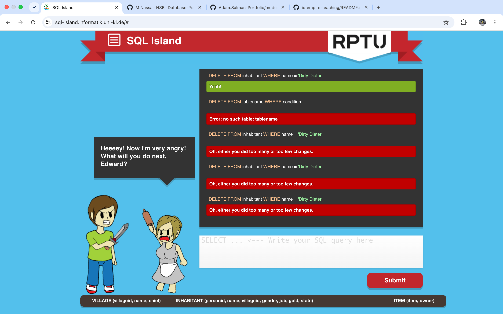

# SQL Island

**1. What did I learn about databases and SQL?**
A database stores information in tables, and SQL lets me ask questions about
that data or change it. I learned to read, filter, sort and summarize data,
join tables, and modify rows.

**2. Which commands did I use?**
SELECT, FROM, WHERE, AND, OR, LIKE, IS NULL, ORDER BY, COUNT, SUM, AVG,
GROUP BY, joins, UPDATE and DELETE.

**3. What is a table, a row, a column and a query?**
A table holds one kind of thing, like the inhabitants. A column is one
property, like name or gold. A row is one entry, like one person. A query is
a question I write in SQL to get data out of the tables.

**4. What surprised me, and what is still confusing?**
Surprised: the game checks which columns I return, so SELECT * was wrong when
it wanted one column. Also, NULL needs IS NULL, not =.
Still confusing: why 'Stranger' and 'stranger' give different results (text inside quotes is case-sensitive), and why my DELETE said "too many or too few changes" when I ran it more than once.
