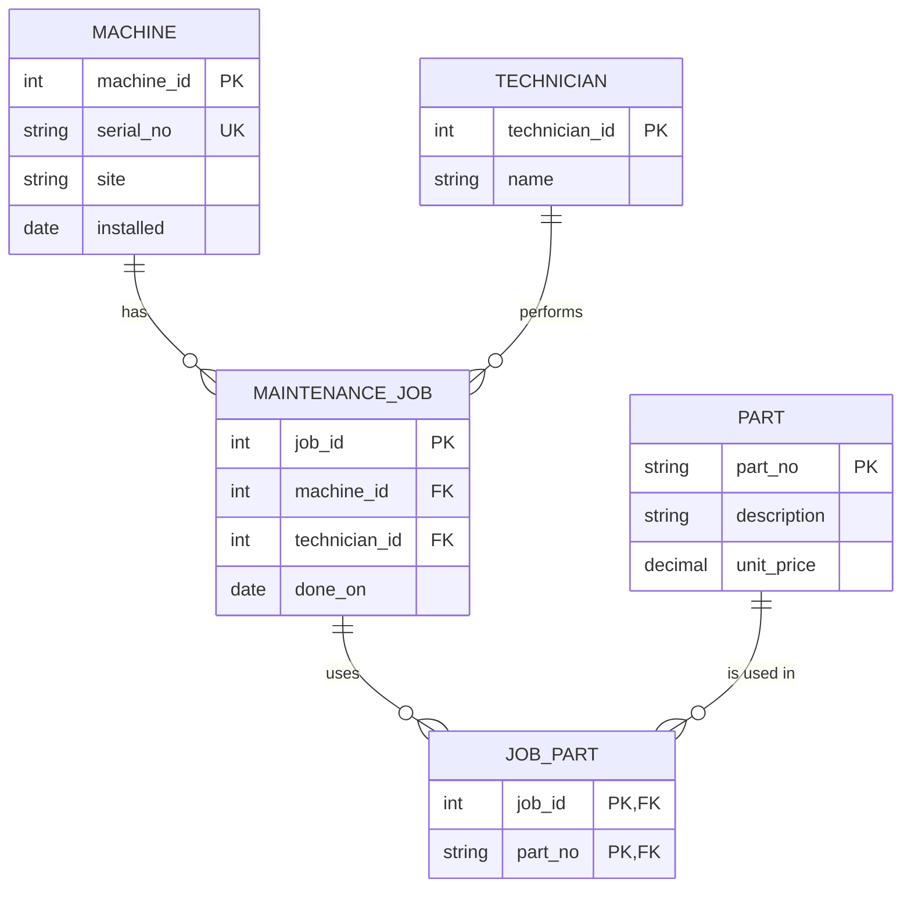

# Module 2: ER audit of the legacy maintenance schema

Setup script: [setup_legacy.sh](setup_legacy.sh). Queries: [audit.sql](audit.sql). Results: [audit-results.txt](audit-results.txt).

## 1. Entities, attributes and intended keys

| Entity | Attributes | Intended primary key |
|---|---|---|
| Machine | serial_no, name, site, installed | machine_id (surrogate), serial_no UNIQUE (natural key) |
| Part | part_no, description, unit_price | part_no (natural key) |
| MaintenanceJob | done_on, machine, technician | job_id |
| Technician | name | technician_id (today it is only a text name inside maint_job) |
| JobPart (junction) | job_id, part_no | (job_id, part_no) together |

## 2. Reconstructed ER diagram

## 3. Cardinalities, proved with counts

- Job 1 has `parts_used = 'P-1001,P-1002'`, so n_parts = 2. One job uses many parts, and P-1001 is used by jobs 1 and 3. This is **m:n**.
- cnc-01 has 2 jobs, but every job names one machine. This is **1:n** (Machine to Job).
- Beier did 2 jobs, but every job has one technician. This is **1:n** (Technician to Job).

## 4. What the legacy schema models and what it hides

- **1:1:** not modeled. Nothing in the schema is one-to-one.
- **1:n:** only half-modeled. Jobs point to a machine by *name*, with no foreign key, so it cannot be enforced.
- **m:n:** hidden. The job-to-part link is a comma-separated text list instead of a junction table, which breaks 1NF.

## 5. Integrity defects, proved with queries

| # | Defect | Proof (result) | What breaks in production |
|---|---|---|---|
| 1 | Orphan job | Job 3 points to `cnc-05`, which is not in `machine` | The job cannot be linked to a real machine or site, so its repair history is lost |
| 2 | Duplicate natural key | `P-1003` appears 2 times | Joins count the part twice, so stock and cost reports are wrong |
| 3 | Price stored as text | `unit_price < '15'` returns 12.50 but **misses 9.90** | Price filters and totals give wrong answers, which means wrong invoices |
| 4 | Date stored as text | `RANDOM-NAME` has `installed = 'unknown'` | Age and warranty calculations fail or silently skip the machine |
| 5 | List in a column (1NF) | The join on `parts_used` drops job 1 (2 parts) and shows job 2 twice | "Which parts did we replace on this machine?" gives a wrong answer without any error |
