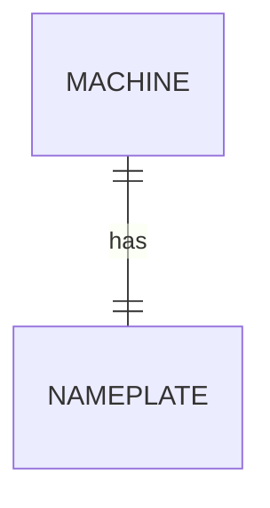
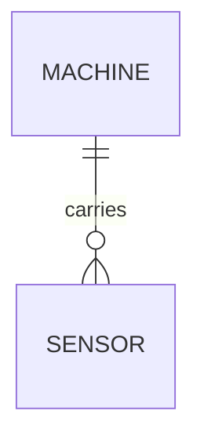
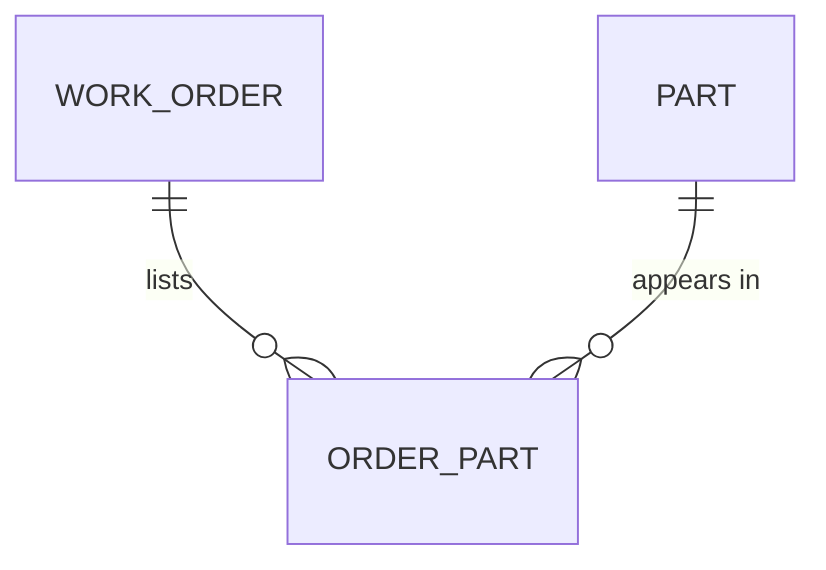
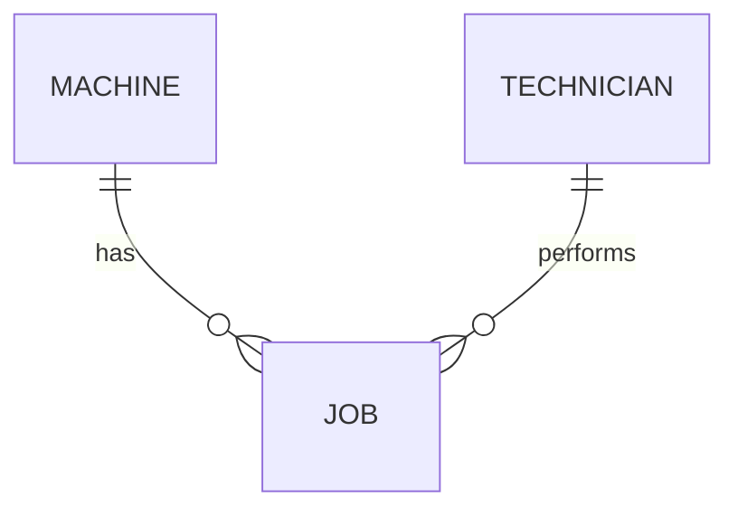

# Module 2: Study log

## 1. References I used (and the concept each taught me)
| Source | Concept I understood best from it |
|---|---|
| [Wikipedia: Entity–relationship model](https://en.wikipedia.org/wiki/Entity%E2%80%93relationship_model) | Entities, attributes and relationships, and how Crow's-foot notation draws 1:1, 1:n and m:n |
| [Wikipedia: Natural key](https://en.wikipedia.org/wiki/Natural_key) / [Surrogate key](https://en.wikipedia.org/wiki/Surrogate_key) | A surrogate key is an invented number; the natural key should still be UNIQUE |
| [Wikipedia: First normal form](https://en.wikipedia.org/wiki/First_normal_form) | One cell = one value, so a comma-separated list breaks 1NF |
| [sqlite.org/foreignkeys.html](https://sqlite.org/foreignkeys.html) | SQLite does not check foreign keys unless `PRAGMA foreign_keys = ON` |

## 2. Things I looked up
- **Junction table:** a table in the middle of an m:n relationship whose key is both foreign keys together (Wikipedia, ER model).
- **Orphan row:** a row that points to something that does not exist, like job 3 pointing to `cnc-05`.

## 3. Remarkable things
- The price filter `unit_price < '15'` **missed 9.90**, because text is compared letter by letter and "9" comes after "1". The query ran without any error and still gave a wrong answer.
- Joining on the comma list made job 1 **disappear** and showed job 2 **twice**. Again, no error message at all.
- `part_no` looked like a key, but `P-1003` exists twice. A natural key without UNIQUE is not really a key.

## 4. LLM Q&A
| Prompt (to Claude) | Short answer | How I verified it |
|---|---|---|
| "What entities and cardinalities does this legacy schema hide?" | Machine, Part, MaintenanceJob, Technician; jobs-to-parts is m:n hidden in `parts_used` | I counted with `n_parts` (job 1 has 2 parts) and `GROUP BY` (cnc-01 has 2 jobs): [audit-results.txt](audit-results.txt) |
| "Why does a comma-separated list break 1NF?" | One cell holds several values, so it cannot be joined or constrained | Defect 5: the join lost job 1 completely |
| "Natural key vs surrogate key?" | Natural = real data (serial number), surrogate = invented number; keep UNIQUE on the natural one | Defect 2: without UNIQUE, P-1003 was stored twice |

## 5. Two best ER sketches I found
1. **Wikipedia, ER model article: example diagram in Chen notation.** It taught me that relationships can be drawn as their own shape (a diamond) and can even have attributes.
2. **Wikipedia, ER model article: Crow's-foot notation figure.** It taught me how to *read* the line ends: one bar = exactly one, the crow's foot = many.

## 6. Task B: from words to sketch

**1:1, Machine and Nameplate.** The key can go on either side, with UNIQUE. Since each machine has exactly one nameplate, the nameplate could also just be attributes of the machine.

**1:n, Machine and Sensor.** The foreign key goes on the "many" side: `sensor.machine_id`.

**m:n, Work order and Part.** Needs a junction table `order_part` with the key `(order_id, part_no)`, so a part can be listed only once per order.

**Entity vs attribute vs relationship, Maintenance job.** The job is an **entity**, because it has its own data (date, parts) and its own id. The technician is also an entity, because one technician does many jobs and a name alone is not unique.

**Proof of the m:n sketch:** [task-b-proof.sql](task-b-proof.sql), results in [task-b-proof-results.txt](task-b-proof-results.txt). Order 1 uses 2 parts, and part P-1002 is used by 2 orders.

## 7. Agreed learning (pod discussion)
*(To be filled in after the pod session with [Mohamed Elsayed](https://github.com/mbahnasy426/Mohamed-Hamed) and [Adam](https://github.com/adamhsalman-droid/Adam.Salman-Portfolio).)*
