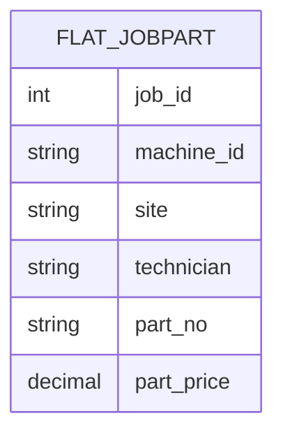
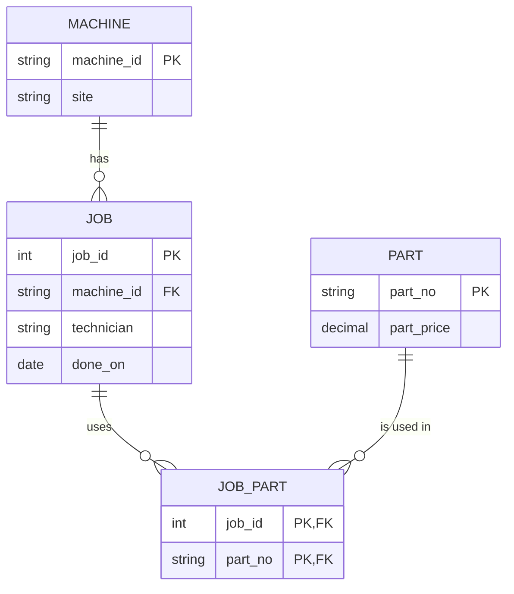

# Module 5: Normalization notes

## Round 1: functional dependencies (the five-row extract)
| FD | Guaranteed by the domain, or only observed? | Why |
|---|---|---|
| `job_id → machine_id, technician, done_on` | **Guaranteed** | A job happens on one machine, by one technician, on one date |
| `machine_id → site` | **Guaranteed** | A machine stands in one place |
| `part_no → part_price` | **Guaranteed** (at one point in time) | A part has one list price; if prices change over time, the price really depends on (part_no, date) |
| `machine_id → technician` | Only observed | cnc-01 always has tech-0 here, but any technician can work on any machine |
| `technician → machine_id` | Only observed | tech-0 only appears with cnc-01 in five rows: an accident |
| `→ site = 'Gütersloh'` for every row | Only observed | All five rows happen to be in Gütersloh; the 200k table also has Bielefeld |
| `part_price → part_no` | Only observed | Every price is different here, but two parts could cost the same |

**Candidate key:** `(job_id, part_no)`. Neither alone is enough: a job has several parts, and a part appears in several jobs. Together they determine every other column.

**LLM diff:** *to do*: ask ChatGPT with the module's prompt and note which "observed" FDs it promotes to real ones. My expectation is that it will list `machine_id → technician`, because it holds in all five rows.

### Two ER sketches
**The table as it is:** one wide entity, with everything on every row.

**The schema it should be (3NF):**

**Gate answer ("which arrow disappears?"):** the dependencies that ran *through* the wide row disappear. `job_id → site` was only true because `job_id → machine_id → site` (transitive), and `(job_id, part_no) → part_price` was only true because `part_no → part_price` (partial). In 3NF, each fact hangs directly off its own key.

## Round 2: anomalies (raw output in [results.txt](results.txt))
- **Update anomaly:** `UPDATE flat5 SET site='Bielefeld' WHERE machine_id='cnc-01'` touched **3 rows** for one fact. A second session that only edited job 1 left cnc-01 in **both** Bielefeld and Gütersloh.
- **Insert anomaly:** the only way to store the new part P-0004 was `(NULL, NULL, NULL, NULL, 'P-0004', 9.0)`, a "job" row with no job.
- **Delete anomaly:** `DELETE FROM flat5 WHERE job_id = 1` (2 rows) erased the fact "P-0002 costs 7.00", because job 1 was the only job that used it.

## Round 3: the normal forms and the anomaly each removes
| Form | Rule | Here |
|---|---|---|
| 1NF | One value per cell | Already true here (unlike Module 2's `parts_used` list) |
| 2NF | No non-key column depends on only part of the key | `part_price` depends only on `part_no`, half of `(job_id, part_no)` → moved to `part` |
| 3NF | No non-key column depends on another non-key column | `site` depends on `machine_id`, not on the job → moved to `machine` |

**The DISTINCT assumption:** `INSERT INTO job SELECT DISTINCT job_id, machine_id, technician, done_on` only works because every job has exactly one technician. If one job had two, the primary key on `job_id` would reject the insert. The decomposition checks the model.

## Round 7: curiosities
- **`CROSS JOIN`** turns 20,000 jobs × 10 parts into exactly 200,000 rows.
- **`printf('%.2f', …)` stores money as text** in the flat table, the same defect as Module 2. The 3NF table repairs it with `CAST(part_price AS REAL)`.
- **Only 10 parts, and P-0001 never appears,** although the code says `% 40`.
- **An index made the dashboard slower:** 90.2 ms with `ix_report_machine`, 64.0 ms without it.
- **SQLite allows a bare column in `GROUP BY`** (`site` is selected but not grouped); DuckDB refuses the same query. SQLite's leniency hides a mistake that another database would catch.
- **The report table is 2.7× bigger** than all four 3NF tables together.
- **I don't know yet:** why `ix_report_machine` is chosen at all, when the query does not filter on `machine_id`. My guess is that it delivers rows already sorted by machine for the `GROUP BY`.
